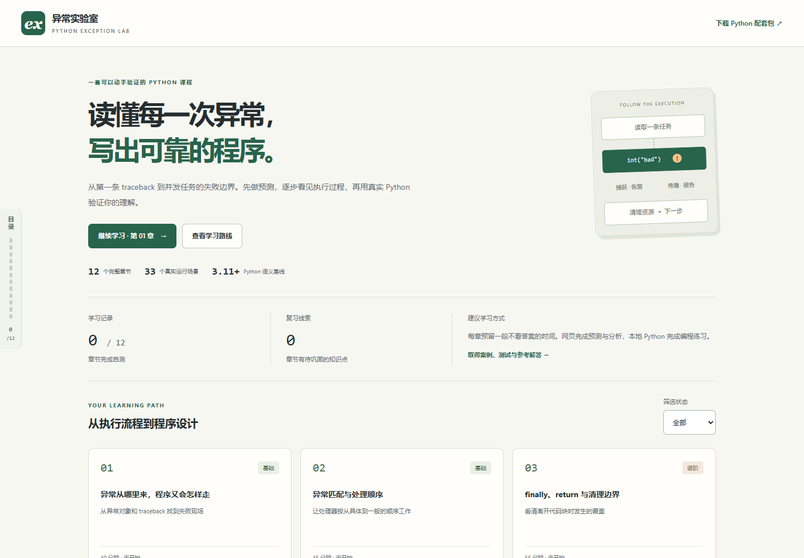

# 异常实验室

一套中文 Python 异常处理交互课程。从第一条 traceback，到异常组、任务取消与可靠任务处理器。

12章 · 36道测验 · 33组完整执行轨迹 · Python本地练习 · MIT许可

[源码仓库](https://github.com/AlexH-0/exception-lab) · [检查记录](https://github.com/AlexH-0/exception-lab/actions)



## 直接学习

下载并解压源码包，用 Edge、Chrome 或 Firefox 打开根目录 **index.html**。Windows也可双击 **Start-Course.cmd**。不需要 Node、Python、账号或本地服务；只复制这个HTML也能离线学习，并下载内嵌的Python配套包。

左侧细条打开课程目录，每章逐节阅读，另设自由实验。学习记录保存在当前浏览器，可在页面底部导出/导入；移动文件或换浏览器前先导出。外部阅读资料需要联网。

## 课程路线

| 章节 | 主题 |
|---|---|
| 01—04 | 异常对象、捕获匹配、finally、跨函数传播 |
| 05—08 | 类型家谱、异常链、自定义契约、上下文管理器 |
| 09—10 | 定位与日志、异常测试、重试与部分失败 |
| 11—12 | 异常组、取消与TaskGroup、综合任务处理器 |

示例行为由真实Python生成或验证，网页回放固定案例。编程练习在本地Python中完成；参考测试通过不代表学习者已完成练习。详见[课程大纲](docs/CURRICULUM.md)。

## 修改网页

需要Node.js 22.12+，建议使用24。项目根目录运行：

```sh
npm ci
npm run dev
```

按终端地址打开。修改后执行：

```sh
npm run check:content
npm test
npm run build
```

构建同步更新根index.html和dist/index.html。app.html是开发模板，不是离线学习入口。安装依赖需要网络；课程本身不请求CDN、远程字体或在线API。

## Python练习与数据

课程语义基线为Python3.11。完整生成数据的逐项比对固定 **CPython3.11.15 / pytest9.1.1**；其他补丁版本可能因版本元数据或错误文案不同而需要审查，不能为消除差异直接覆盖数据。

Windows PowerShell：

```powershell
py -3.11 -m venv .venv
.venv/Scripts/python.exe -m pip install -r requirements.txt
.venv/Scripts/python.exe -B -m pytest tests/python -q -p no:cacheprovider
```

macOS / Linux：

```sh
python3.11 -m venv .venv
.venv/bin/python -m pip install -r requirements.txt
.venv/bin/python -B -m pytest tests/python -q -p no:cacheprovider
```

默认测试参考实现。练习在python/exercises，参考解答在python/solutions；设置COURSE_IMPL=exercises后测试自己的代码，具体命令见[Python手册](python/README.md)。下载包可独立使用，新机器需新建虚拟环境。

修改Python文件或配套资料后，先更新下载包，再构建网页：

```sh
npm run package:python
npm run build
```

## 浏览器检查

Windows默认使用已安装的Edge；其他系统默认Playwright Chromium。首次安装浏览器，统一使用项目内目录。Windows PowerShell：

```powershell
$env:PLAYWRIGHT_BROWSERS_PATH = '0'
npx playwright install chromium firefox
# 可选：改用Chromium
$env:COURSE_BROWSER_CHANNEL = 'chromium'
```

macOS / Linux：

```sh
export PLAYWRIGHT_BROWSERS_PATH=0
npx playwright install chromium firefox
```

保持这些环境变量后运行：

```sh
npm run test:e2e
npm run test:offline -- --project file-edge
```

离线/扩展脚本使用项目内的浏览器目录。Firefox需设置PLAYWRIGHT_BROWSERS_PATH=0后执行 `npx playwright install firefox`；CI同样使用项目内Chromium。配置中的file-edge项目在非Windows系统使用Chromium。

视觉比较单独运行 `npm run test:visual`；现有基准为Windows Edge的desktop/mobile尺寸，其他系统须先生成候选、人工审看，再提交认可的基准。不得把覆盖截图当作检查通过。扩展缩放测试需Windows Edge。

[当前验收记录](docs/QA_RELEASE.md)区分已运行检查与未验证平台。GitHub Actions已配置Windows/Linux源码检查与Linux Chromium浏览器检查，首次远程运行结果仍需确认；不把配置文件当作实机通过证明。

## 贡献与发布

修改约定见[贡献说明](CONTRIBUTING.md)，源码导出与发布步骤见[发布指南](docs/RELEASE_GUIDE.md)。`npm run release:source` 生成独立源码目录与ZIP，保留可运行入口、依赖锁、Python资料及测试，不附带本机环境或开发历史。此步骤需要项目.venv。

## 许可

项目原创代码与课程内容采用[MIT许可](LICENSE)。JetBrains Mono保留SIL OFL 1.1，React、React DOM、scheduler和PrismJS保留各自MIT声明，详见[第三方许可](docs/THIRD_PARTY_NOTICES.md)。外部链接中的文章不属于本项目许可范围。
